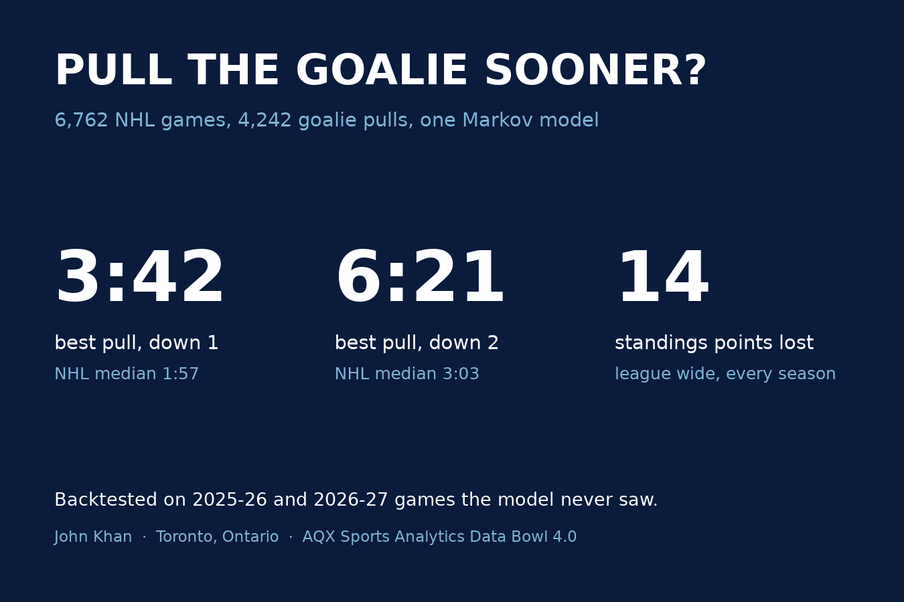
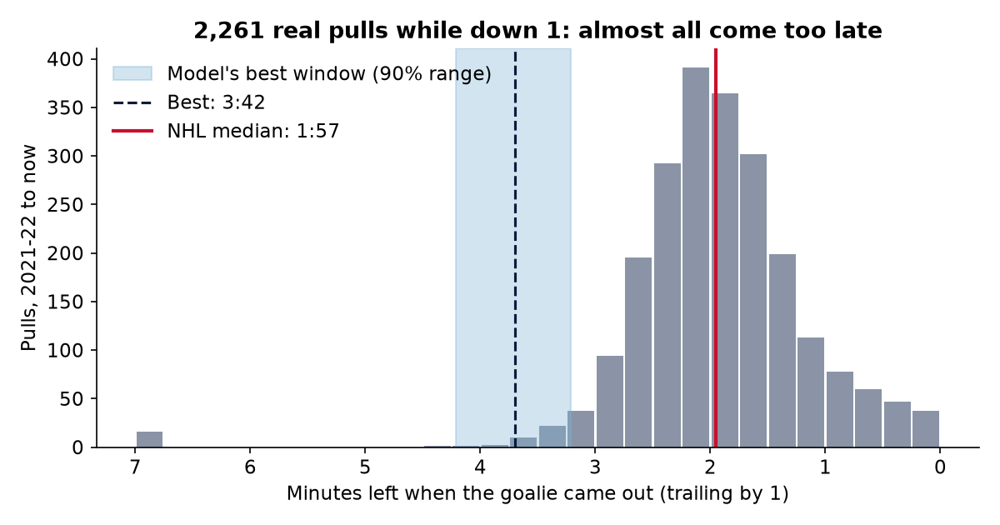
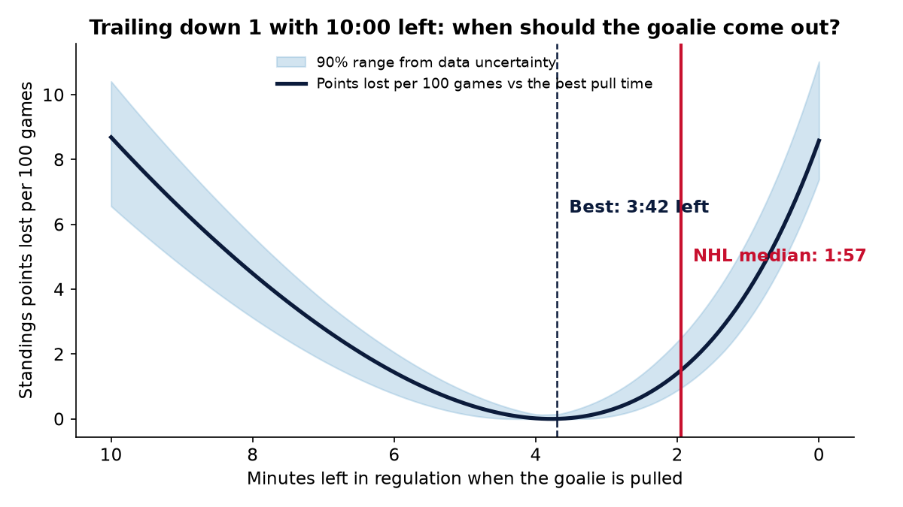
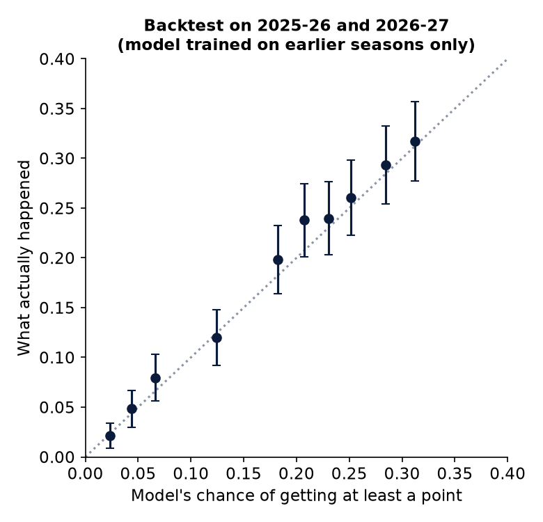
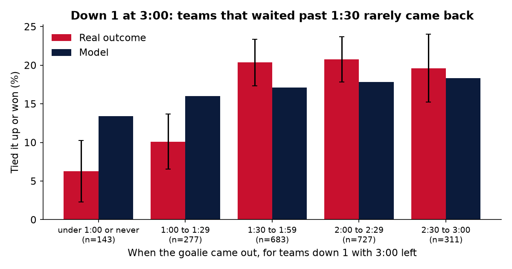
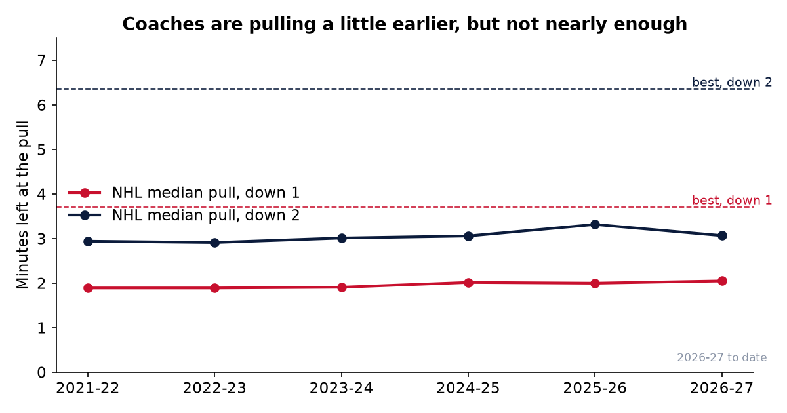

# Pull the Goalie Sooner?

**When should a trailing NHL team pull its goalie?** I tracked every goalie pull in 6,762 NHL regular season games since 2021 using the league's public play by play feed, built a second by second model of the last ten minutes, and backtested it on games it never saw.



| | Best time to pull | NHL median | 90% range |
|---|---|---|---|
| Down 1 | **3:42 left** | 1:57 | 3:13 to 4:13 |
| Down 2 | **6:21 left** | 3:03 | 5:05 to 7:55 |
| Down 1, playoffs | **3:58 left** | | |
| Down 2, playoffs | **6:35 left** | | |

* About **1 in 100** pulls while down 1 comes at the right time or earlier.
* Waiting costs the league about **14 standings points every season** (about 0.43 per team), and 98% of that comes from pulling too late, not too early.
* From the moment the model says pull while down 1, pulling then instead of at the NHL median raises the chance of getting at least a point from 19.1% to 20.3% and expected standings points from 0.292 to 0.313 per game.

**Live dashboard:** open `docs/index.html` through any static host (GitHub Pages serves the `docs/` folder as is). Pick a score, a clock and a team and the bench tool says PULL NOW or WAIT, with the value of each choice.

## What is in here

```
scripts/fetch_games.py     downloads play by play from api-web.nhle.com, one gzipped file per season
scripts/run_analysis.py    goal rates, optimal pull times, uncertainty, backtests, team table, docs/data/results.json
scripts/make_charts.py     every chart in docs/img
src/pullgoalie/parse.py    situation codes to time segments, goalie pull detection, delayed penalty filter
src/pullgoalie/model.py    the Markov chain, backward induction, fixed policy grids, live recommend()
src/pullgoalie/analysis.py exposure tables and backtest states
src/pullgoalie/live.py     live or replayed game reader plus a small JSON API with chat vote endpoints
docs/                      the dashboard (index.html, app.js, style.css), the shared JS model, a stream overlay
tests/                     unit tests for the model, the parser, and Python and JavaScript agreement
```

## Run it

Python 3.10 or newer.

```bash
pip install -r requirements.txt
python scripts/fetch_games.py          # about 2 minutes per season, roughly 17 MB in total
python scripts/run_analysis.py --rebuild
python scripts/make_charts.py
python -m pytest -q
cd docs && python -m http.server 8000  # then open http://localhost:8000
```

## Method

1. **Data.** Every regular season game from 2021-22 to October 28, 2026 from `api-web.nhle.com/v1/gamecenter/{id}/play-by-play`. Each event has a four digit situation code (away goalie, away skaters, home skaters, home goalie), so `0651` means the away team has six skaters and an empty net.
2. **Time segments.** Between two events the game state is constant unless the code changes, in which case the gap is split at the midpoint. That gives exposure time for every score, manpower and goalie state.
3. **Strategic pulls only.** A goalie leaving for a delayed penalty looks the same as a pull. Any goalie out stretch that ends with a penalty called on the other team within 75 seconds is dropped. What is left is 4,242 first pulls while trailing in the third period.
4. **Goal rates.** Third period goals for and against per 60 minutes, by score and goalie state. Down 1 with the goalie in, a team scores 2.47 and allows 2.10. With the goalie out it scores 6.90 and allows 20.30 (48 hours of 6 on 5 play).
5. **Model.** A continuous time Markov chain in one second steps over the score difference, solved backwards from the final horn. In the regular season a tie after 60 minutes is worth one point plus a 50% shot at the second (comeback teams actually won 52.3% of 363 overtimes), so the model maximises expected standings points. Playoff mode maximises win chance.
6. **Uncertainty.** Each goal rate gets a Gamma posterior (Jeffreys prior). 400 posterior draws, each solved again, give the 90% range on the best pull time.
7. **Team view.** Each team's own 6 on 5 rates from 2024-25 onward are blended with the league rate (a prior worth 8 hours of play), because a team plays well under an hour of 6 on 5 a season.

## Backtest

All goal rates were fit on 2021-22 to 2024-25 only. The test set is every 2025-26 and 2026-27 game where a team trailed by one or two goals at 10:00, 8:00, 6:00, 5:00, 4:00, 3:00, 2:00 or 1:00 left: 5,168 game states from 1,045 games. The model never sees outcomes; it only knows the rates, the clock and when that team actually pulled.

| Out of sample | Brier | Log loss | AUC |
|---|---|---|---|
| Markov model, all manpower states, actual pull time | **0.1385** | **0.4335** | **0.690** |
| Markov model, even strength only, actual pull time | 0.1389 | 0.4349 | 0.690 |
| Same model, everyone pulls at the league median | 0.1394 | 0.4369 | 0.685 |
| Lookup table of past comeback rates by score and clock | 0.1391 | 0.4360 | 0.685 |

* Average predicted chance of getting at least a point was 17.3% against 18.2% observed, and every decile sits close to the diagonal (`docs/img/calibration.png`).
* Knowing when a team actually pulled makes the model better than a lookup table that ignores timing. That is direct evidence that pull timing changes outcomes in the way the model says.
* In the raw data, teams down 1 with 3:00 left who waited until under 1:30 to pull came back 6% to 10% of the time. Teams that pulled with 1:30 or more left came back about 20% of the time.







## Robustness

| Assumption | Down 1 | Down 2 |
|---|---|---|
| Main: all seasons, standings points, overtime 50/50 | 3:42 | 6:21 |
| Playoff mode | 3:58 | 6:35 |
| Overtime win rate 45% or 55% | 3:41 to 3:43 | 6:20 to 6:22 |
| Train seasons only | 3:23 | 7:05 |
| Trailing 5 on 5 rates from the whole third period | 3:50 | 6:25 |
| All manpower states | 3:39 | 6:55 |
| 2024-25 onward only | 4:13 | 5:28 |

Under every assumption I tried, the best time down 1 is between 3:23 and 4:13, and the NHL median is 1:57.

## Limits

* Both teams are treated as league average unless you choose a team, and opponents are not adjusted.
* Faceoff zone and possession are not modelled. Coaches usually pull on an offensive zone draw or with control of the puck, so the practical advice is to start looking for that moment a little before the best time.
* Down 3 or more, the model says pull almost any time in the third, because losing by four costs nothing more in the standings than losing by three. The sample there is small.
* Penalties enter the backtest model at their real frequency but not the decision itself. A team on a power play late should pull even earlier.

## Live and stream ready

The same model exists in Python (`src/pullgoalie/model.py`) and dependency free JavaScript (`docs/pullgoalie.js`), and the tests check that both give the same pull times.

```bash
pip install -e .                                          # or prefix commands with PYTHONPATH=src
python -m pullgoalie.live --game 2026020150             # current call for both teams
python -m pullgoalie.live --game 2025021312 --at 240    # replay a finished game at 4:00 left
python -m pullgoalie.live --serve --port 8787
```

The server exposes `/today`, `/state?game=ID`, `/vote?game=ID&choice=pull|wait&user=NAME` and `/votes?game=ID` with open CORS. `docs/overlay.html?game=ID` is a transparent stream overlay that shows the model's call next to the crowd's vote. A chat bot that reads `!pull` and `!wait` only needs to call `/vote`.

## Data and credits

Data from the NHL's public play by play feed at api-web.nhle.com. NHL and team names are trademarks of their owners; this project is independent and not endorsed by the NHL.

Built by John Khan, Toronto, Ontario. MIT License.
